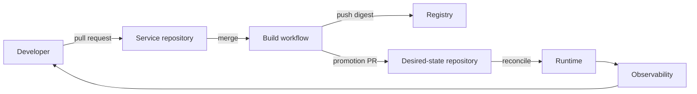

# T-PLT-05-I — Intermediate Practice

*Chapter: [T-PLT-05 — Platform Product Thinking and Architecture](README.md) · Part 4 — Platform Engineering*

<a id="t-plt-05-i"></a>
#### T-PLT-05-I — Intermediate Practice

## Why this matters

The Beginner section gave you the vocabulary: users, jobs, golden paths, cognitive load. Practice begins when you must turn that vocabulary into decisions with evidence behind them. Which problem do you fix first, when forty teams each describe a different pain? Where does the platform end and the product team begin, in a way both can point to? How does a developer find out that a service exists, who owns it and whether it is healthy? How do you know the platform is getting better rather than merely busier?

This section covers six practical skills: **user research** that a small team can run, **service boundaries** that make ownership explicit, a **catalogue** that stays truthful, **discovery** of services and capabilities, **metrics** that survive scrutiny, and **onboarding and prioritisation** that connect the rest. It also shows how to record architecture as text that diffs in Git. It assumes the Beginner material. Examples use the fictional `orders-api`, `checkout` and `payments` teams; the chapter depends on no other course material.

A recurring theme: **a platform claim is only as strong as the independent evidence behind it.**

## Why a portal alone is not a platform

| What you installed | What it proves | What it does *not* prove |
| --- | --- | --- |
| A portal running | A web application is up | That anyone can create a deployable service |
| Templates configured | A form submits | That the output builds, passes policy, deploys and is observable |
| A catalogue populated | Entities exist | That owners, runbooks and status are correct |
| A documentation site | Pages exist | That a stranger can follow them without help |
| A positive internal demo | The author can drive it | Anything about independent use |

A portal, CLI, template or README is an *interface*. The evidence of a platform is a trial with a real, independent user. Build the path first, then the interface that exposes it.

## User research a small team can run

A platform team rarely has a research function. It still needs evidence about users, and four cheap methods cover most needs.

| Method | What it tells you | Cost | Trap |
| --- | --- | --- | --- |
| Observed task trial | Where a real person stalls on a defined task | One hour per participant | Helping the participant |
| Short interview | The user's situation, workarounds and fears | 30 minutes | Asking for feature requests instead of recent stories |
| Support-channel analysis | What people ask for help with, and how often | A few hours of tagging | Counting threads, not distinct people |
| Behavioural data | What people actually do (templates used, pages visited, commands run) | Instrumentation effort | Mistaking activity for success |

**Interview for stories, not opinions.** "What would you like from the platform?" invites a wish list. "Tell me about the last time you created a new service" invites a story, and stories contain the real obstacles. Useful prompts:

1. Walk me through the last time you shipped something to production. What did you do first?
2. What did you do when you got stuck? Whom did you ask?
3. What do you do outside the platform because the platform path was awkward?
4. What would make you nervous about changing this on a Friday?
5. What do you avoid asking about, and why?

**Sample size.** Five to eight participants per user group reveal most recurring problems. Choose people with different tenure and different teams; the person who volunteers is rarely typical.

**Tag the support channel.** A simple tagging scheme turns noise into a ranked list.

```text
Tag            Meaning                                     Count (30 days)  Distinct teams
access         Needed permission or identity setup               41              14
pipeline-red   Build or check failed, cause unclear              37              19
env-request    Needed an environment or namespace                22               9
how-do-i       Question answered by existing docs                18              11
docs-wrong     Documentation was out of date                      9               6
```

The last two rows are distinct signals. *how-do-i* means documentation is hard to find; *docs-wrong* means it is incorrect. Both are platform defects.

**Synthesis.** After a round of research, write each finding as *observation, evidence, number of people affected, severity*. Resist writing solutions in the same sentence. A finding is "five of seven participants did not know which namespace to deploy to (stuck point, 12 minutes average)", not "we need a namespace picker".

## Service boundaries: where the platform ends

A platform offers **services** to its users: self-service capabilities with an interface, a promise and an owner. Naming them forces clarity about what the platform *does* and *does not* do.

**A service definition.** Each platform service has the same short description.

```yaml
name: service-creation
owner: platform-team
users: [product developer]
interface: command line plus template repository
promise: a new service, deployable and observable, within 30 minutes of starting
support: business hours; response within 4 working hours
not_covered:
  - stateful services
  - non-standard runtimes
documentation: docs/service-creation.md
evidence: acceptance trial results, quarterly
```

The `not_covered` list matters as much as the promise.

**The platform contract — who owns what**

| Concern | Platform owns | Developer owns |
| --- | --- | --- |
| Namespace, quota, deployer identity | Tenant manifest and policy | Chooses service name and owner |
| Build pipeline and signing | Reusable workflows | Code and tests |
| Deploy mechanism | GitOps | Decides when to promote |
| Probes, limits, security context defaults | The template | Tunes values within limits |
| Telemetry plumbing, dashboard template | The platform | Business metrics, keeps runbook current |
| First response to incidents | Support route and docs | Service-specific diagnosis and fixes |
| Data durability for stateful services | Patterns and guidance only | Backup choices and restore tests |

A contract nobody wrote down is an assumption.

**Boundary tests.** When you doubt where a responsibility belongs, ask:

| Question | If yes |
| --- | --- |
| Does every team need it, and does it add no insight? | Candidate for the platform (extraneous load) |
| Does it depend on knowledge of one team's domain? | Stays with the team |
| Can a mistake affect other teams? | The platform sets guardrails |
| Would the team be unable to operate their service without understanding it? | Do not hide it; make it visible |
| Will a human decision genuinely be needed each time? | A designed, time-boxed human gate |

**Choose the runtime scope and say so.** A platform usually has one primary runtime (for example Kubernetes with GitOps, or a managed container service) and records the decision: alternatives, cost, what is *not* claimed. Different pathways for teams on other runtimes are adapted knowingly rather than silently.

## The catalogue: a truthful list of what exists

A **software catalogue** records entities (services, libraries, teams, environments, resources) and the relationships between them. It answers questions that otherwise cost a chat thread: who owns this, where is the runbook, what does it depend on, is it healthy?

**Minimum entity record**

```yaml
apiVersion: catalogue.example/v1
kind: Service
metadata:
  name: orders-api
  description: Creates and tracks customer orders
  tags: [tier-2, python]
spec:
  owner: team-checkout
  lifecycle: production
  system: ordering
  dependsOn: [service:payments-api, resource:orders-database]
  links:
    runbook: https://docs.example.com/orders-api/runbook
    dashboard: https://metrics.example.com/d/orders-api
    repository: https://git.example.com/checkout/orders-api
```

**Truthfulness is the hard part.** A catalogue fails when records drift from reality. Defences:

| Defence | Mechanism |
| --- | --- |
| Generate, do not hand-write | The service template creates the record from the repository |
| Keep it next to the code | The record lives in the service repository and changes by pull request |
| Validate on every change | CI rejects a record with no owner or an unknown team |
| Detect rot | A scheduled job flags records whose owner left or whose runbook link returns an error |
| Show age | Display "last verified" so users judge trust |

**What a populated catalogue does not prove.** It proves entities exist, not that owners respond, runbooks work or statuses are correct. Test by calling the owner named in a record and following a runbook link during a drill.

**Entity-model discipline.** Start with few kinds (service, team, environment). Every new kind needs a named owner and a stated question it answers. A catalogue with thirty kinds and no owners is a database nobody trusts.

## Discovery: helping people find what exists

Discovery covers how a developer learns that a capability, service or owner exists *before* building their own.

| Need | Typical mechanism | Failure |
| --- | --- | --- |
| "Who owns this service?" | Catalogue record and a link from every dashboard and alert | Owner field points to a disbanded team |
| "Is there already a service that does this?" | Catalogue search by tag, domain and API description | Descriptions are empty or boilerplate |
| "How do I do X on the platform?" | One documentation entry point organised by task | Docs organised by tool |
| "What changed?" | Release notes and a visible change log | Announcements in chat that scroll away |
| "Who do I ask?" | A single support route with a response target | Three channels, none staffed |

**Organise by task, not by tool.** Developers think "deploy a service" or "get a database", not "Tool A reference". A task-based index (create, change, observe, recover, retire) mirrors the golden path.

**Test discovery like a feature.** Give a new colleague five questions ("who owns the payment-retry service?", "where is its runbook?") and time how long each takes without asking a person. Each failure is a discovery defect.

## Metrics that survive scrutiny

Beginner metrics measure one trial. At this level you track them over time and across teams, and you add flow and reliability measures.

| Metric | Why it matters | How to compute | Caution |
| --- | --- | --- | --- |
| Time to first deploy (new service) | Core promise of the golden path | Service created to first healthy instance, median and 90th percentile | Report percentiles, not only the average |
| Time to second deploy | Is the path usable beyond a demo? | Same, for the second service from the same team | A fast first and slow second hints at hidden help |
| Intervention rate | How self-service the path is | Interventions per task from trials and support tags | Needs consistent definition |
| Golden path adoption | Voluntary preference | New services on the path divided by all new services | Mandates invalidate it |
| Delivery metrics for users | Platform effect on flow | Lead time for changes, deploy frequency, change failure rate, restore time for teams using the path | Never use to rank teams |
| Platform reliability | Trust in the promises | Success rate of the service creation and deploy workflows | Count the user's view of failure, not only the system's |
| Developer sentiment | The felt experience | A short regular survey (three to five questions) | Low response rates; survey fatigue |

**Define before you measure.** For each metric write the definition, data source, owner, review cadence and the decision it informs. A metric that informs no decision is decoration.

**Segment.** An overall median hides that new joiners take three times longer than veterans, or that one language is twice as painful. Segment by tenure, language and team type.

**Use leading and lagging together.** Lagging metrics (adoption, delivery performance) move slowly. Leading ones (stuck points per trial, docs freshness, support tags) tell you earlier whether you are improving.

**Never turn user metrics into targets for individual teams.** If delivery metrics become a league table, teams game them, and the measure stops reflecting reality. Use them to find where the platform helps or fails.

## Onboarding: the first hour is a product

Onboarding is where the golden path first meets a real person. Treat it as a feature with a test.

**An onboarding path**

| Stage | Target outcome | Evidence |
| --- | --- | --- |
| Access | Identity, permissions and tooling working | A checklist the new person completes alone |
| First change | A small change merged and deployed to a non-production environment | Pull request, deploy record |
| First observation | They find the service's logs and health in the platform | They answer a set question unaided |
| First incident drill | They follow a runbook for a simulated failure | Drill timeline |
| First service | They create a new service from the template | Acceptance record |

**Onboarding anti-patterns**

| Anti-pattern | Result | Fix |
| --- | --- | --- |
| A document that assumes prior context | New joiners ask in chat; knowledge stays tribal | Test with someone who has never seen it |
| Permissions requested one by one | First week lost to access | Role-based bundles granted on day one |
| Onboarding written once | Steps rot silently | Owner and review date; rerun quarterly |
| No definition of "done" | Nobody knows when onboarding ended | An acceptance check |

**Record every onboarding as research.** Each new joiner is a free observed trial. Add one question: "what slowed you down?"

## Prioritisation: choosing what to fix next

A platform team has more problems than capacity. Prioritise with evidence and make the reasoning visible.

**Score problems by frequency, severity and reach.**

| Factor | Question | Scale |
| --- | --- | --- |
| Reach | How many developers or teams hit it per quarter? | Number of people |
| Frequency | How often per person? | Times per month |
| Severity | What does it cost each time? | Minutes lost, or risk of an outage or breach |
| Confidence | How sure are we of the numbers? | Low, medium, high |
| Effort | How much work to fix? | Person-weeks |

A simple score: *(reach × frequency × severity × confidence) ÷ effort*. The number is not truth; it makes assumptions visible and arguments specific.

A worked example:

```text
Problem                         Reach  Freq/mo  Severity(min)  Conf  Effort(pw)  Score
Access requests take two days     40      1         60         0.9      3         720
Pipeline errors unclear           35      4         25         0.8      4         700
Namespace picker confusing        12      1         12         0.6      1          86
New dashboard theme requested      5      1          3         0.5      2          4
```

Here access and pipeline errors dominate. The dashboard theme is attractive and loud but small.

**Beyond the score**

| Category | Treatment |
| --- | --- |
| Safety or security | May outrank the score; document the rule |
| Foundational work (upgrades, reliability) | Reserve a visible share of capacity (for example 20 to 30 percent) |
| Strategic bets | Time-boxed, with a hypothesis and a stopping condition |
| Requests from senior people | Record, score, answer openly |

**Say no well.** Every declined request gets a reason, a pointer to a workaround and a revisit date. A written "not now" preserves trust; silence destroys it.

## Architecture as text that diffs in Git

Architecture documents that cannot be reviewed drift. Keep them as text next to the code.

| View | Contents |
| --- | --- |
| Context | Users, the platform, external systems |
| Components and flows | Source repository, CI, registry, desired-state repository, controller, cluster, observability |
| Trust boundaries | Where untrusted code runs, where credentials live, who can change production-shaped state |
| Ownership table | Who owns each resource, which controller reconciles it, whether it may be pruned |

A component view as text:



A diagram is useful only if its edges have owners. Annotate each arrow with *who controls it* and *what credential it uses*.

## Architecture decision records

A minimum set for a platform: runtime and scope; platform boundary and golden-path contract; delivery trust model (review, CI, digest, provenance and what provenance does *not* prove); deployment identity, tenancy and policy; state and data; observability, SLOs and runbook ownership; secrets and access; cost and operations.

```markdown
# ADR-004: One primary runtime for the golden path
Status: Accepted (2026-03-02)   Revisit: when more than 20% of services request another runtime
## Context
Forty teams; four platform engineers; support capacity is the binding constraint.
## Decision
Support one primary runtime. Teams on other runtimes use a documented exit.
## Alternatives considered
- Two runtimes (rejected: doubles on-call surface)
- A managed container service only (rejected: limited policy control)
## Consequences
+ Smaller support surface; faster improvement of one path
- Teams with unusual needs pay an integration cost
## Evidence
Support-tag analysis Q1; cost estimate in docs/costs.md
```

Each ADR states *context, decision, alternatives, consequences (good and bad), evidence link and revisit trigger*.

**The limitations register.** Keep one row per honest gap: *gap, impact, compensating control, would fix by*. Typical entries: the practice cluster is single-node; a read role is cluster-wide; secrets are base64 in etcd; recovery of data depends on a copy outside the cluster. Maintain it from the start, not the night before a demonstration.

## What can go wrong: common mistakes and how they look

| Mistake | Symptom | Fix |
| --- | --- | --- |
| Interviewing for features | A list of requests that match no observed problem | Ask for recent stories |
| Counting threads, not people | One noisy team dominates priorities | Count distinct teams |
| Catalogue without verification | Owners who no longer exist | Generate, validate, detect rot |
| Docs organised by tool | Users cannot find the task | Reorganise by task |
| Averages only | New joiners suffer unseen | Report percentiles and segments |
| Metrics as league tables | Gaming, defensiveness | Use for diagnosis, never ranking |
| No capacity for foundations | Upgrades postponed until an incident | Reserve a visible share |
| Silent refusals | Teams build workarounds | Written "not now" with a reason |
| Boundary decided in an incident | Disputes at 3 a.m. | Written contract in advance |
| Limitations found in demos | Credibility loss | Register from day one |

## Knowledge consolidation

- A **portal is an interface**; the evidence of a platform is an independent user succeeding.
- Cheap research: **observed trials, story-based interviews, tagged support data, behavioural data**. Synthesise findings as observation, evidence, reach and severity.
- A **platform service** has an owner, interface, promise, support route and a `not_covered` list; the **contract table** says who owns what.
- A **catalogue** is valuable only if truthful: generate records, keep them in the repository, validate and detect rot.
- **Discovery** is organised by task and tested with timed questions.
- Metrics need **definitions, data sources and decisions**; report percentiles, segment, and never rank teams.
- **Onboarding** is a testable first-hour product and a free source of research.
- **Prioritise** by reach, frequency, severity, confidence and effort; reserve capacity for foundations and decline openly.
- Record architecture as **text that diffs**, decisions as **ADRs** with revisit triggers, and gaps in a **limitations register**.

## Exercises

**Exercise 1 — Interview.** Interview two developers using the prompts above. Write five findings in the form *observation, evidence, people affected, severity*, without proposing solutions.

**Exercise 2 — Tag and rank.** Take thirty days of support questions (or invent forty realistic ones), tag them, and compute count and distinct teams per tag. Explain how ranking changes when you rank by distinct teams.

**Exercise 3 — Define a platform service.** Write the service definition for one platform capability, including promise, support, `not_covered` and evidence. Then write the matching two rows of the contract table.

**Exercise 4 — Catalogue audit.** For five services you know, write catalogue records. Check each against reality: does the owner respond, does the runbook link work, does the dependency list match what the service calls? Report the percentage that were true.

**Exercise 5 — Discovery test.** Write five discovery questions a new colleague should answer unaided. Time someone. List the fixes for each failure.

**Exercise 6 — Score a backlog.** Score six problems using the formula above. Then override the ranking for one item for a safety reason, and write the sentence that justifies it.

**Exercise 7 — Write an ADR.** Record one real or plausible platform decision in the ADR format, including a revisit trigger that is measurable.

**Exercise 8 — Limitations register.** Write the ownership table and a limitations register with at least five honest entries for a platform you know.

**Solution notes.**

*Exercise 1.* Check that each finding contains a number and no solution. "Developers dislike the portal" is an opinion; "four of six participants could not find where logs appear (stuck point, average 9 minutes)" is a finding.

*Exercise 2.* Ranking by distinct teams usually promotes problems that are widespread but quiet, and demotes loud single-team issues. The difference is the lesson.

*Exercise 3.* A good `not_covered` list excludes something a user would reasonably expect. If it is empty the promise is probably vaguer than you think.

*Exercise 4.* Expect between a quarter and half of records to contain at least one false fact on the first audit. That is typical, and the measure of improvement is the share after you add generation and validation.

*Exercise 5.* Typical failures are documentation organised by tool and an owner field naming a former team. Fix by task-based indexes and rot detection.

*Exercise 6.* The override is legitimate if the reason is explicit and the item is recorded as an exception, not folded silently into the score.

*Exercise 7.* A strong revisit trigger names a number or an event ("when more than 20 percent of services request another runtime"), not a date alone.

*Exercise 8.* Honest entries are uncomfortable: single-node practice environments, broad read roles, secrets stored without encryption at rest, data recovery depending on a copy outside the cluster. Each needs a compensating control and a plan.
